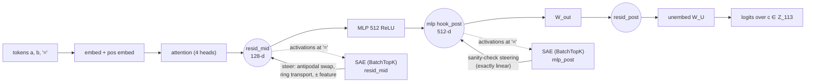

# Sparse autoencoders on the grokked modular-addition transformer

**Status: stage-1 preregistration, before any results.** No model has been trained yet. This README describes the planned study. Results, figures and tables will be generated into this file by `python run.py report` as experiments finish.

## What this is

**In plain words.** A tiny neural network learned to add numbers on a clock with 113 hours: it answers (a + b) mod 113. Researchers have already worked out *how* it does this. It turns each number into positions on a few circles ("Fourier frequencies"), combines them, and reads off the answer ([Nanda et al. 2023](https://arxiv.org/abs/2301.05217)).

We train **sparse autoencoders (SAEs)** on its internal activations. SAEs are a popular tool for splitting a network's activations into human-interpretable "features". Because the true algorithm is known, we can check what SAE features really are instead of guessing. We then *steer* features (turn them up, down, flip them or move them along their circle) to see whether that makes the network compute something new, for example **a + b + δ instead of a + b**.

**In technical terms.**
- We train BatchTopK SAEs ([Bussmann et al. 2024](https://arxiv.org/abs/2412.06410)) with [SAELens](https://github.com/decoderesearch/SAELens) on the MLP input (`hook_resid_mid`) and MLP output (`hook_post`) of the 1-layer, p = 113 modular-addition transformer.
- We score every feature against ground-truth mechanism coordinates. For each key frequency k, z_k = e^{iw_k a} + e^{iw_k b}, with angle ψ_k and radius r_k (the "A+B" representation in [Lin 2025](https://arxiv.org/abs/2510.00468) and the "Pizza" algorithm in [Zhong et al. 2023](https://arxiv.org/abs/2306.17844)), and compare against the "Clock" torus coordinates (θ_a, θ_b).
- Steering at the MLP *output* is exactly linear in the logits here (no LayerNorm, zero biases), so we treat it only as a sanity check. The confirmatory steering happens at the MLP *input*, through the ReLU nonlinearity. The interventions are:
  1. antipodal latent swaps (predicted to leave the answer unchanged under Pizza);
  2. **ring transport**: moving active latents along their recovered circle (predicted to make the model output a + b + δ);
  3. signed single-feature steering (predicted to be sign-symmetric under Pizza).
- These predictions differ between the Clock and Pizza algorithms, so the steering experiments also test which algorithm this exact model implements.

**Novelty.** In our literature search (2026-11-27) we found no peer-reviewed study that trains SAEs on this model and tests feature steering against the known algorithm ([literature review](reports/literature-review.md)). The closest work uses the model only as an appendix benchmark for crosscoders ([Manning-Coe et al. 2026](https://arxiv.org/abs/2606.09940)).

## Rigor

- **Preregistration before results**: [reports/preregistration.md](reports/preregistration.md), committed before any training. It has two stages: exploration on one dev base model (seed 999), then a frozen stage 2 before 10 confirmatory base models (seeds 0–9).
- **Unit of inference**: each independently trained base model, with a hierarchical bootstrap (base seed → SAE seed → inputs) and Holm correction.
- **No leakage**: SAE splits are made by *unordered* pair {a, b}, so (a,b) and (b,a) never straddle splits. Steering shifts δ and target sums are split into dev and test halves.
- **Baselines and controls**:
  - PCA, ICA, NMF, k-means and a supervised mechanism dictionary;
  - a surrogate SAE trained on idealized-mechanism activations;
  - DiffMean, a minimum-norm oracle and oracle plane rotations;
  - real counterfactual inputs and norm-matched random directions;
  - SAEs on an untrained model, a memorization-phase checkpoint and a constant-attention (Pizza-prone) model.
- **Planned runs**: [reports/planned-runs.md](reports/planned-runs.md).

## Architecture



## Planned pipeline (what happens when you run it)

1. `train-base`: train the 1-layer transformer for 40k full-batch epochs, saving checkpoints. It groks after about 10k epochs.
2. `mechanism`: key frequencies, neuron FVE, restricted/excluded loss, Clock vs Pizza diagnostics.
3. `collect`: cache activations at the '=' position for all 12,769 inputs.
4. `train-sae`: SAELens `SAETrainer` on in-memory activations (SAE-train split only).
5. `characterize`: feature maps over the 113×113 grid, arc-model fits in mechanism coordinates, rings, line decomposition, logit effects.
6. `steer`: interventions I1–I4 with baselines and dose–response curves.
7. `report`: every table and figure regenerated from `results/`, injected into this README and the paper.
8. `site`: export data for the interactive GitHub Pages explorer.

## Installation

```powershell
git clone https://github.com/BurnyCoder/sparse-autoencoders-on-modular-addition-transformer
```
```powershell
cd sparse-autoencoders-on-modular-addition-transformer
```
```powershell
uv sync
```
```powershell
Copy-Item .env.example .env
```

Requires an NVIDIA GPU with CUDA 12.8+ drivers for the default PyTorch index (see `pyproject.toml`). CPU also works, just more slowly.

## Technologies

Python 3.13, [uv](https://docs.astral.sh/uv/), PyTorch 2.11 (CUDA 12.8), [TransformerLens 4.4](https://github.com/TransformerLensOrg/TransformerLens), [SAELens 6.56](https://github.com/decoderesearch/SAELens), scikit-learn, SciPy, matplotlib, [trackio](https://huggingface.co/docs/trackio) (live training dashboard), Typst (paper), GitHub Pages (interactive site), Hugging Face Hub (weights).

## To-do

- [x] Literature and state-of-the-art review
- [x] Stage-1 preregistration and run matrix
- [ ] Pipeline with tests (TDD)
- [ ] Dev base model + mechanism report
- [ ] Dev SAEs, feature characterization, steering exploration
- [ ] Stage-2 preregistration (frozen thresholds and config)
- [ ] Confirmatory seeds 0–9, controls, baseline dictionaries
- [ ] Ablations (architecture, m × k, site)
- [ ] Paper (`reports/paper.pdf`), interactive site, HF collection

## Citation

Libor "Burny" Burian, *Sparse autoencoders on the grokked modular-addition transformer*, 2026. https://github.com/BurnyCoder/sparse-autoencoders-on-modular-addition-transformer
